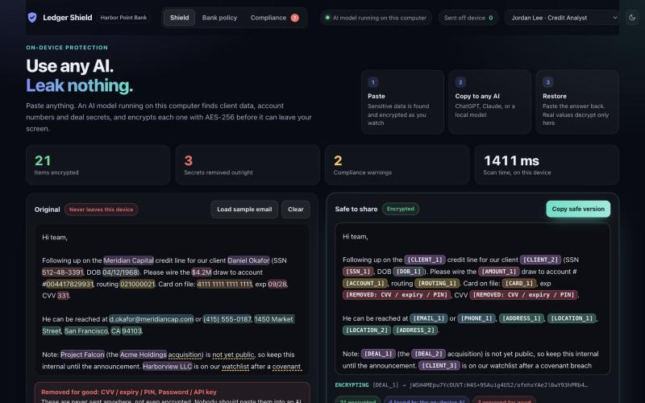
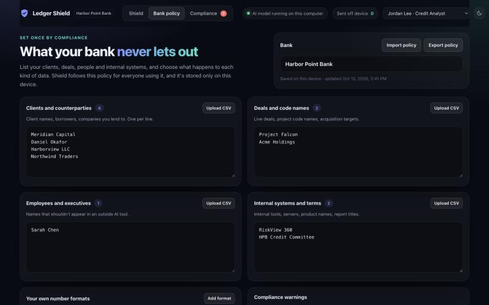

# Ledger Shield: use any AI, leak nothing



**Install on a Mac:** download [Ledger-Shield.dmg](https://github.com/philiprmocanu-cell/SanFran44/releases/latest/download/Ledger-Shield.dmg), open it, drag Ledger Shield to Applications. First launch: right-click the app → Open (it isn't notarized yet). Everything, including the AI model, runs on the Mac with no internet.

**Try it in a browser:** https://philiprmocanu-cell.github.io/SanFran44/



Banks ban AI tools because staff paste client data into them, and staff use AI anyway on their phones. **Ledger Shield** sits in between:

1. **Paste anything.** A local AI model running on your own computer (bert-base-NER, run in the browser with no internet) plus bank rules find names, companies, SSNs, account, routing and card numbers, emails, phones, addresses, amounts and deal code names.
2. **Each one is encrypted live** with AES-256-GCM, using a key that never leaves the device, and replaced by a token like `[PERSON_1]`.
3. **Copy the safe version into any AI** (ChatGPT, Claude, a local model).
4. **Paste the AI's answer back.** Tokens are decrypted on your device, so the real names and numbers come back only on your screen.
5. **Bank policy page:** compliance lists clients, deals, employees, internal systems and the bank's own number formats, and picks Encrypt / Remove / Off for each kind of data. Passwords, API keys, CVVs and PINs are removed outright. Warnings flag inside information, confidential credit opinions and regulator exam findings.
6. **Compliance view:** every encryption, safe copy, blocked raw copy and inside-information warning is logged by employee. The log records the type of data, never the data itself.

The "Sent off device" counter proves nothing leaves: it counts every request to another server after the page loads.

Open it at **http://localhost:8080** (redirects to `/shield/`). Before the first build, download the local model (about 130 MB, kept out of git):

```bash
./gateway/static/shield/download_model.sh
```

---

# Ledger Check: a sealed AI analyst for banks

Banks ban AI tools because staff can paste customer data into them. Ledger Check is an AI credit analyst that physically can't touch bank data:

- **Sealed container.** The AI runs on a network with no route to the internet. Its only exit is a firewall that allows public SEC filings and the AI provider, nothing else.
- **No bank files.** Nothing is mounted in. The disk is read-only, and it runs without admin rights.
- **Logged-out browser.** Every web request is a fresh session with no cookies or sign-ins.
- **Data guard.** Every question is scanned before it reaches the AI. SSNs, card numbers, routing and account numbers, emails, phone numbers, "confidential" markings, pasted spreadsheets and the bank's own protected terms are blocked outright.
- **Audit log.** Every question, block and firewall decision is recorded.

## Run it

Needs Docker and an `ANTHROPIC_API_KEY` in `.env`.

```bash
docker compose up -d --build
```

Then open http://localhost:8080

### Or as a Mac app

```bash
./macapp/build.sh
```

This builds **Ledger Check.app** and installs it in /Applications. Opening it starts Docker (OrbStack or Docker Desktop) if needed, builds and seals the containers, and shows the app in its own window. On first launch it asks for an Anthropic API key, which is saved only on that Mac. Quitting the app stops the containers.

Needs Xcode command line tools (`xcode-select --install`).

## Demo script (2 minutes)

1. **Check a borrower.** Real SEC numbers, red flags, and what to ask next.
2. **Paste customer data.** Blocked before the AI ever sees it.
3. **Reach the bank's intranet.** The AI tries, and the firewall blocks it. The audit log shows it.
4. **Run isolation test.** The container tries to break out 9 ways and fails every time.

## Parts

| Folder | What it is |
|---|---|
| `gateway/` | The app and data guard: the only door in |
| `sandbox/` | The AI analyst: sealed network, read-only, no mounts |
| `egress/` | The firewall, with the allowlist in `egress/allowlist.txt` |

Add a bank's client names or project code names to `GUARD_TERMS` in `docker-compose.yml`.
